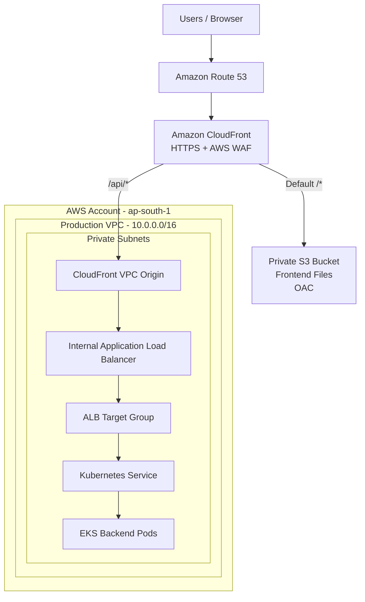

# AWS Production Architecture
## CloudFront + S3 + Private ALB + Amazon EKS

**Architecture:** CloudFront VPC Origin with an internal Application Load Balancer.

**AWS Region:** ap-south-1 (Mumbai)

**Example domain:** example.com

---

# 1. Architecture Diagram



## 1.1 Frontend Request Flow

1. User opens `https://www.example.com`.
2. Route 53 resolves the domain to CloudFront.
3. CloudFront receives the request.
4. CloudFront matches the default behavior `/*`.
5. CloudFront fetches frontend files from S3 using OAC.
6. Browser receives the frontend application.

## 1.2 Backend Request Flow

1. Frontend calls `/api/users`.
2. Browser sends the request to CloudFront.
3. CloudFront matches `/api/*`.
4. CloudFront forwards the request to VPC Origin.
5. VPC Origin connects to the internal ALB.
6. ALB forwards traffic to the EKS backend.
7. Backend processes the request.
8. Response returns through ALB and CloudFront.

---

# 2. AWS Resources Required

| Service | Resource | Purpose |
|---|---|---|
| VPC | Production VPC | Network |
| VPC | Internet Gateway | VPC Origin prerequisite |
| VPC | Private Subnets | ALB and EKS |
| VPC | Security Groups | Network security |
| EKS | EKS Cluster | Kubernetes |
| EC2 | Worker Nodes | Backend workloads |
| ELB | Internal ALB | Backend routing |
| S3 | Private Bucket | Frontend hosting |
| CloudFront | Distribution | Public entry point |
| CloudFront | VPC Origin | Private ALB connectivity |
| CloudFront | OAC | Private S3 access |
| ACM | Viewer Certificate | Browser HTTPS |
| ACM | Origin Certificate | ALB HTTPS |
| Route 53 | Hosted Zone | DNS |
| WAF | Web ACL | Application security |
| CloudWatch | Logs and Alarms | Monitoring |

---

# 3. Network Architecture

## 3.1 Example VPC Configuration

| Resource | CIDR |
|---|---|
| VPC | 10.0.0.0/16 |
| Public Subnet A | 10.0.1.0/24 |
| Public Subnet B | 10.0.2.0/24 |
| Private Subnet A | 10.0.11.0/24 |
| Private Subnet B | 10.0.12.0/24 |
| Private Subnet C | 10.0.13.0/24 |

## 3.2 Create VPC

1. Open AWS Console.
2. Navigate to VPC.
3. Select Your VPCs.
4. Click Create VPC.
5. Select VPC only.
6. Enter the following:

| Setting | Value |
|---|---|
| Name | production-vpc |
| IPv4 CIDR | 10.0.0.0/16 |
| Tenancy | Default |

7. Create the VPC.

## 3.3 Create Subnets

Create two public subnets and at least two private subnets across different Availability Zones.

Use private subnets for:

- Internal ALB.
- EKS worker nodes.
- CloudFront VPC Origin managed ENIs.

## 3.4 Attach Internet Gateway

1. Navigate to Internet Gateways.
2. Click Create Internet Gateway.
3. Name it `production-igw`.
4. Attach it to `production-vpc`.

**Important:** An Internet Gateway must be attached to the VPC for CloudFront VPC Origins. This does not make your internal ALB publicly accessible.

## 3.5 Route Tables

### Public Route Table

| Destination | Target |
|---|---|
| 10.0.0.0/16 | Local |
| 0.0.0.0/0 | Internet Gateway |

### Private Route Table

| Destination | Target |
|---|---|
| 10.0.0.0/16 | Local |
| 0.0.0.0/0 | NAT Gateway (if required) |

---

# 4. EKS Configuration

## 4.1 EKS Cluster

| Setting | Recommended Value |
|---|---|
| Cluster Name | production-eks |
| Region | ap-south-1 |
| VPC | production-vpc |
| Subnets | Private subnets |
| Public API Endpoint | Disabled or restricted |
| Private API Endpoint | Enabled |

## 4.2 Node Group

| Setting | Example |
|---|---|
| Name | backend-nodegroup |
| Subnets | Private |
| Desired Capacity | 2 |
| Minimum Capacity | 2 |
| Maximum Capacity | 6 |

Choose instance types according to application requirements.

## 4.3 Install AWS Load Balancer Controller

The controller manages ALBs through Kubernetes Ingress resources.

High-level steps:

1. Configure kubectl.
2. Configure IAM permissions.
3. Configure IRSA or EKS Pod Identity.
4. Install the controller using Helm.
5. Verify controller Pods.

```bash
helm repo add eks https://aws.github.io/eks-charts

helm repo update
```

Follow the official AWS installation guide:

https://docs.aws.amazon.com/eks/latest/userguide/aws-load-balancer-controller.html

## 4.4 Backend Kubernetes Deployment

```yaml
apiVersion: apps/v1
kind: Deployment
metadata:
  name: backend
  namespace: production
spec:
  replicas: 3
  selector:
    matchLabels:
      app: backend
  template:
    metadata:
      labels:
        app: backend
    spec:
      containers:
        - name: backend
          image: ACCOUNT_ID.dkr.ecr.ap-south-1.amazonaws.com/backend:VERSION
          ports:
            - containerPort: 8080
          readinessProbe:
            httpGet:
              path: /health
              port: 8080
```

Use immutable image tags in production.

## 4.5 Backend Service

```yaml
apiVersion: v1
kind: Service
metadata:
  name: backend-service
  namespace: production
spec:
  type: ClusterIP
  selector:
    app: backend
  ports:
    - port: 80
      targetPort: 8080
      protocol: TCP
```

---

# 5. Internal Application Load Balancer

## 5.1 ALB Configuration

| Setting | Value |
|---|---|
| Type | Application Load Balancer |
| Scheme | Internal |
| VPC | production-vpc |
| Subnets | Private |
| Listener | HTTPS 443 |
| Target Type | IP |
| Health Check | /health |

## 5.2 ALB Security Group

Create:

`sg-internal-alb`

Inbound:

| Protocol | Port | Source |
|---|---|---|
| TCP | 443 | CloudFront managed VPC Origin SG |

Do not allow public internet ingress.

## 5.3 Kubernetes Ingress

Example:

```yaml
apiVersion: networking.k8s.io/v1
kind: Ingress
metadata:
  name: backend-ingress
  namespace: production
  annotations:
    alb.ingress.kubernetes.io/scheme: internal
    alb.ingress.kubernetes.io/target-type: ip
    alb.ingress.kubernetes.io/listen-ports: '[{"HTTPS":443}]'
    alb.ingress.kubernetes.io/certificate-arn: REGIONAL_CERTIFICATE_ARN
    alb.ingress.kubernetes.io/healthcheck-path: /health
spec:
  ingressClassName: alb
  rules:
    - http:
        paths:
          - path: /
            pathType: Prefix
            backend:
              service:
                name: backend-service
                port:
                  number: 80
```

Apply:

```bash
kubectl apply -f backend-ingress.yaml
```

Verify:

```bash
kubectl get ingress -n production
kubectl get pods -n production
kubectl get svc -n production
```

---

# 6. ACM Certificates

Two separate certificates may be required.

## 6.1 CloudFront Viewer Certificate

Region: `us-east-1`

Request a public certificate for:

- example.com
- www.example.com

Choose DNS validation.

Add the generated ACM CNAME validation records to Route 53.

Wait for certificate status:

`Issued`

## 6.2 ALB Origin Certificate

Region: `ap-south-1`

Request a separate certificate if using HTTPS from CloudFront to ALB.

The certificate must cover the origin hostname used for TLS validation.

Do not assume the ALB-generated DNS name matches your application certificate.

---

# 7. S3 Configuration

## 7.1 Create S3 Bucket

Example:

`production-frontend-assets`

| Setting | Value |
|---|---|
| Block Public Access | Enabled |
| Versioning | Enabled |
| Encryption | Enabled |
| Object Ownership | Bucket owner enforced |
| Website Hosting | Disabled |

## 7.2 Configure OAC

Create an Origin Access Control:

| Setting | Value |
|---|---|
| Origin Type | S3 |
| Signing Behavior | Sign requests |
| Signing Protocol | SigV4 |

Attach OAC to the S3 origin.

## 7.3 S3 Bucket Policy

Replace placeholders with actual values.

```json
{
  "Version": "2012-10-17",
  "Statement": [
    {
      "Sid": "AllowCloudFrontReadOnly",
      "Effect": "Allow",
      "Principal": {
        "Service": "cloudfront.amazonaws.com"
      },
      "Action": "s3:GetObject",
      "Resource": "arn:aws:s3:::production-frontend-assets/*",
      "Condition": {
        "StringEquals": {
          "AWS:SourceArn": "arn:aws:cloudfront::ACCOUNT_ID:distribution/DISTRIBUTION_ID"
        }
      }
    }
  ]
}
```

---

# 8. CloudFront VPC Origin

## 8.1 Prerequisites

- Supported AWS Region.
- Internet Gateway attached.
- Internal ALB deployed.
- ALB security group configured.
- Private subnet with available IPv4 addresses.
- Required IAM service-linked role permissions.

## 8.2 Create VPC Origin

1. Open CloudFront.
2. Navigate to VPC Origins.
3. Click Create VPC Origin.
4. Select the internal ALB.
5. Enter `production-backend-vpc-origin`.
6. Configure origin protocol and port.
7. Create the VPC Origin.
8. Wait for status `Deployed`.

## 8.3 Security Group

AWS creates a managed security group:

`CloudFront-VPCOrigins-Service-SG`

Do not modify this AWS-managed security group.

Configure the ALB security group to allow the managed group as its source.

Example:

| Type | Port | Source |
|---|---|---|
| HTTPS | 443 | CloudFront managed SG |

AWS documentation:

https://docs.aws.amazon.com/AmazonCloudFront/latest/DeveloperGuide/private-content-vpc-origins.html

---

# 9. CloudFront Distribution

## 9.1 Create Origins

### Origin 1: S3

| Setting | Value |
|---|---|
| Origin ID | frontend-s3 |
| Origin | S3 REST endpoint |
| Access | OAC |

### Origin 2: Backend

| Setting | Value |
|---|---|
| Origin ID | backend-vpc-origin |
| Origin | CloudFront VPC Origin |
| Target | Internal ALB |

## 9.2 Default Behavior

| Setting | Value |
|---|---|
| Path Pattern | Default (*) |
| Origin | frontend-s3 |
| Viewer Protocol | Redirect HTTP to HTTPS |
| Methods | GET, HEAD, OPTIONS |
| Cache Policy | CachingOptimized |

## 9.3 API Behavior

| Setting | Value |
|---|---|
| Path Pattern | /api/* |
| Origin | backend-vpc-origin |
| Viewer Protocol | Redirect HTTP to HTTPS |
| Methods | GET, HEAD, OPTIONS, PUT, POST, PATCH, DELETE |
| Cache Policy | CachingDisabled |

Forward the required:

- Authorization header.
- Content-Type header.
- Query strings.
- Application-specific cookies.
- Custom headers.

Use a custom origin request policy if necessary.

Avoid forwarding unnecessary headers and cookies.

## 9.4 Custom Domain

Add:

```text
example.com
www.example.com
```

Attach the ACM certificate from `us-east-1`.

Enable HTTPS.

---

# 10. Route 53 Configuration

## 10.1 Hosted Zone

Create or reuse a public hosted zone:

`example.com`

## 10.2 ACM Validation Records

Add the CNAME records generated by ACM.

These records validate ownership of the domain.

Keep them for automatic renewal.

## 10.3 CloudFront Alias Records

After CloudFront is deployed, create:

| Name | Type | Alias | Target |
|---|---|---|---|
| example.com | A | Yes | CloudFront |
| www.example.com | A | Yes | CloudFront |
| example.com | AAAA | Yes | CloudFront |
| www.example.com | AAAA | Yes | CloudFront |

Create AAAA records if IPv6 is enabled.

**Important:** Do not point Route 53 to the internal ALB.

---

# 11. Frontend API Configuration

Use a relative API URL.

```javascript
export async function getUsers() {
  const response = await fetch("/api/users", {
    method: "GET",
    headers: {
      "Content-Type": "application/json"
    }
  });

  if (!response.ok) {
    throw new Error("API request failed");
  }

  return response.json();
}
```

The browser calls CloudFront, not ALB.

The `/api/*` behavior routes requests to the backend.

---

# 12. AWS WAF

Attach a Web ACL to CloudFront.

Consider:

- AWS Managed Common Rule Set.
- Known Bad Inputs.
- IP Reputation.
- Rate-based rules.
- SQL injection protection.
- Application-specific restrictions.

Start new managed rules in Count mode and review false positives before blocking.

Enable WAF logging.

---

# 13. Deployment Sequence

| Step | Task |
|---|---|
| 1 | Create VPC |
| 2 | Create subnets |
| 3 | Create route tables |
| 4 | Attach Internet Gateway |
| 5 | Configure NAT and endpoints |
| 6 | Configure security groups |
| 7 | Create EKS cluster |
| 8 | Create node group |
| 9 | Install Load Balancer Controller |
| 10 | Deploy backend |
| 11 | Create Kubernetes Service |
| 12 | Request regional ACM certificate |
| 13 | Create internal ALB |
| 14 | Verify ALB health |
| 15 | Create VPC Origin |
| 16 | Configure ALB security group |
| 17 | Create S3 bucket |
| 18 | Upload frontend |
| 19 | Create CloudFront distribution |
| 20 | Configure OAC policy |
| 21 | Request CloudFront ACM certificate |
| 22 | Attach certificate |
| 23 | Configure CloudFront behaviors |
| 24 | Attach WAF |
| 25 | Configure Route 53 |
| 26 | Test the entire application |

---

# 14. Validation

## 14.1 Frontend

```bash
curl -I https://www.example.com
```

Expected: successful frontend response.

## 14.2 Backend

```bash
curl -i https://www.example.com/api/health
```

Expected: successful backend response.

## 14.3 DNS

```bash
dig example.com
dig www.example.com
```

Verify CloudFront DNS resolution.

## 14.4 TLS

```bash
curl -Iv https://www.example.com
```

Verify certificate validity.

## 14.5 Security

Verify:

- S3 cannot be accessed publicly.
- ALB is internal.
- ALB does not allow public ingress.
- EKS nodes are private.
- CloudFront is the public application entry point.

---

# 15. Troubleshooting

| Problem | Possible cause |
|---|---|
| CloudFront 502 | Origin TLS, ALB listener, connectivity |
| CloudFront 403 | S3 OAC or bucket policy |
| API 404 | Incorrect behavior or backend routing |
| API 504 | Backend timeout or unhealthy target |
| VPC Origin deployment failure | Unsupported Region, IGW, subnet IP capacity |
| Authentication failure | Authorization header or cookie forwarding |
| Frontend deep-link 403 | Missing SPA routing configuration |

---

# 16. Final Architecture

```text
                  INTERNET
                     |
                 WEB BROWSER
                     |
                  ROUTE 53
                     |
                CLOUDFRONT
                 + AWS WAF
                     |
           +---------+---------+
           |                   |
           |                   |
         /*                  /api/*
           |                   |
           v                   v
      PRIVATE S3          VPC ORIGIN
          OAC                 |
                              |
                         INTERNAL ALB
                              |
                         TARGET GROUP
                              |
                         EKS SERVICE
                              |
                         BACKEND PODS
```

## Final Recommendation

- CloudFront should be the only public application entry point.
- S3 should remain private using OAC.
- ALB should remain internal in private subnets.
- CloudFront VPC Origin should provide private ALB connectivity.
- Route 53 should point the application domain to CloudFront.
- ACM viewer certificate should be in us-east-1.
- ALB origin certificate should be in ap-south-1 if HTTPS origin connectivity is configured.
- AWS WAF should protect CloudFront.

**End of document.**
